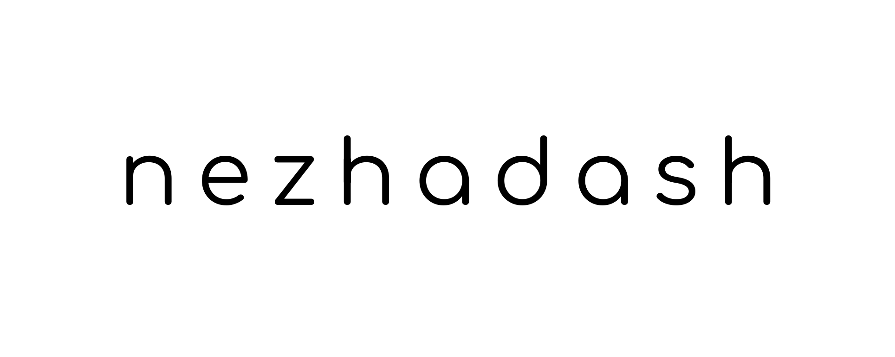

# Komari Linnux 主题

这是为 [Komari Monitor](https://github.com/komari-monitor/komari) 制作的 Linnux 定制主题。



## 功能特点

- 简洁的亮色与暗色服务器监控界面
- 展示服务器状态、资源用量、网络流量和分组筛选
- 支持流量进度条、服务可用性、全球地图和资产卡片等可选功能
- 可在 Komari 的主题管理中配置 Logo、背景图、自定义链接和显示选项

## 安装方法

### 下载安装包（推荐）

1. 从 [Releases](https://github.com/linnux-x/komari-linnux/releases/latest) 下载 `komari-linnux-<版本>.zip`。
2. 打开 Komari 管理面板，进入“主题管理”。
3. 上传压缩包并启用 `komari-linnux` 主题。

安装包由 `.github/workflows/release.yml` 在发布 Release 时自动构建，内含 `dist/`、`komari-theme.json` 和 `preview.png`。

### 从源代码构建

```bash
git clone https://github.com/linnux-x/komari-linnux.git
cd komari-linnux
npm ci
npm run build
```

构建完成后，将生成的 `dist/` 目录和根目录的 `komari-theme.json` 一同压缩为 ZIP 文件，按上面第 2、3 步上传。

## 开发说明

源码中大量出现 `Nezha` 命名（`NezhaServer`、`nezha-api`、`formatNezhaInfo` 等），这是**有意保留的适配层**，不是待清理的历史遗留：本主题的界面派生自 Nezha 主题，`komariToNezhaWebsocketResponse` 负责把 Komari 后端的数据转换成 Nezha 的数据形状，上层组件据此渲染。重命名这些标识符需要连同转换层一起重构，不要单独改名。

### 工具链兼容基线

本主题当前固定在 Node.js 22、Vite 6、Tailwind CSS 3.4 和 TypeScript 5.x 的兼容主版本线，并持续更新这些版本线内的安全与维护补丁。Tailwind 4 与 Vite 8 将最低浏览器基线提高到 Safari 16.4、Chrome 111 和 Firefox 128；在 Komari 面板及目标 WebView 完成视觉、暗色模式、响应式布局和旧浏览器验收前，不把它们作为普通依赖更新混入安全修复。

npm 12 会默认阻止未明确授权的依赖安装脚本。`package.json` 的 `allowScripts` 只允许锁文件中构建所需的 `@swc/core`、`esbuild` 与 macOS 可选的 `fsevents` 版本；升级这些包时必须同步复核并更新精确版本，不使用通配授权。

## 配置说明

在 Komari 的主题管理中可设置站点 Logo、桌面端与移动端背景图、强制主题、顶部链接和卡片显示选项。站点名称和描述优先使用 Komari 后端的站点设置。

## 致谢与许可证

主题设计参考 [Akizon77/nezha-dash-v1](https://github.com/Akizon77/nezha-dash-v1)。Komari 监控后端由 [komari-monitor/komari](https://github.com/komari-monitor/komari) 提供。

本仓库遵循 [Apache License 2.0](LICENSE) 许可证。
